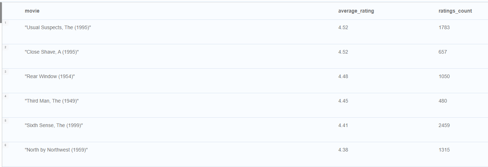
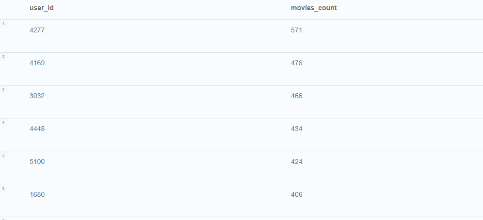
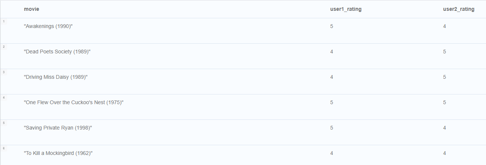
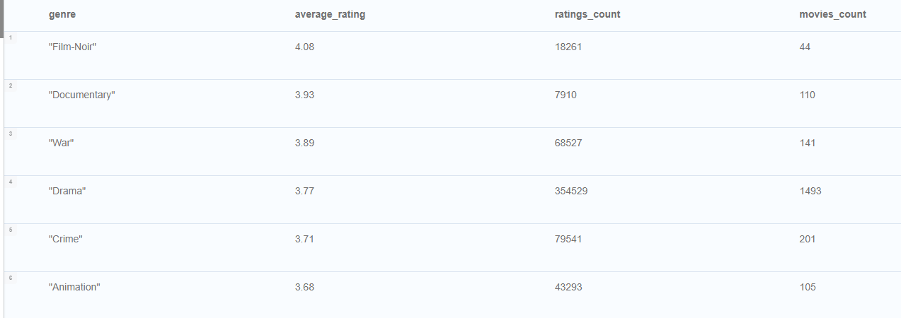
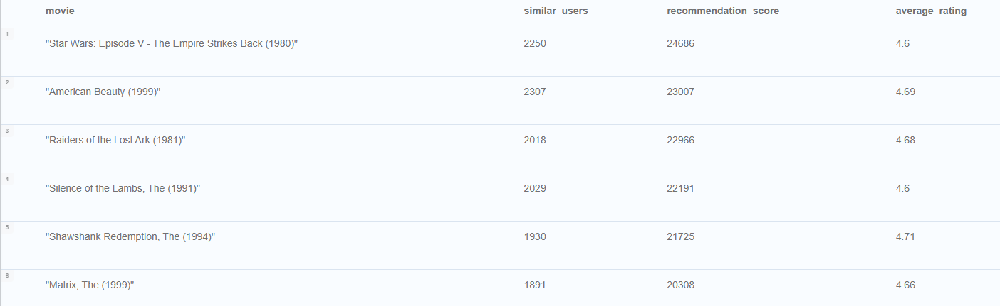
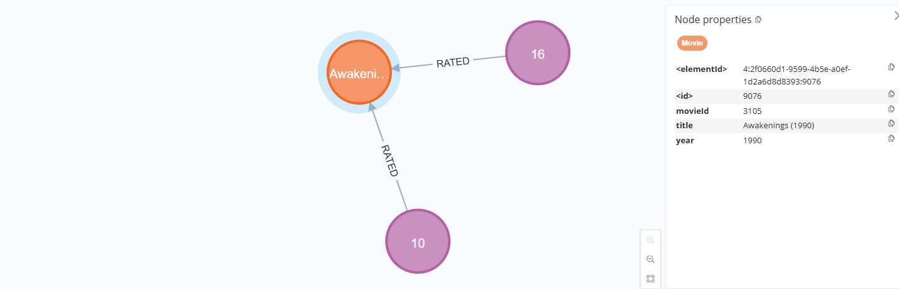
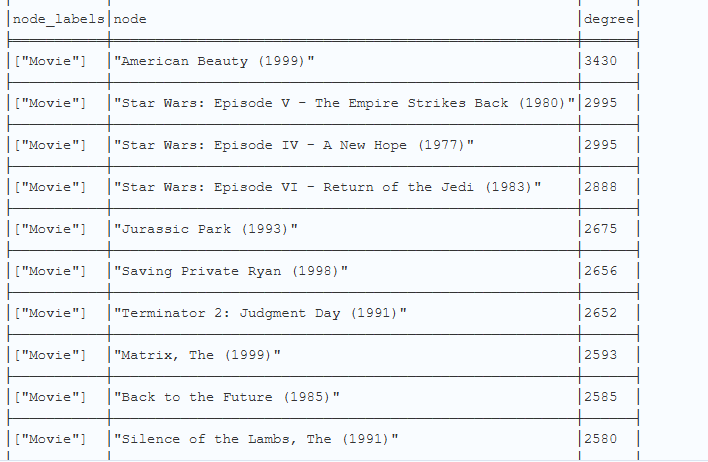

## 1. Проєктування схеми
```
 (User {userId, gender, age, occupation})
    |                             \
    | [:RATED {rating, timestamp}] \ [:RATED {rating, timestamp}]
    v                               v
 (Movie {movieId, title, year})   (Movie {movieId, title, year})
    |             |                   |
    | [:HAS_GENRE]| [:HAS_GENRE]      | [:HAS_GENRE]
    v             v                   v
 (Genre {name}) (Genre {name})     (Genre {name})
    ^                                 |
    |_________________________________|
        один жанр можуть мати
        багато різних фільмів
```
#### 1.1 Вузли: User, Movie, Genre. Вони мають власну ідентичність, атрибути й можуть бути пов'язані з багатьма іншими об'єктами. Наприклад, той самий фільм оцінюють різні користувачі, а той самий жанр описує багато фільмів. Ребра: RATED та HAS_GENRE. Вони позначають відношення між сутностями, в нашому випадку факт оцінювання фільму користувачем і належність фільму до жанру. Така структура природно підходить для обходів графа, наприклад пошуку користувачів зі схожими оцінками або добору фільмів за жанрами.
#### 1.2 Для цієї схеми я обрав варіант ребра RATED із властивостями rating і timestamp, в першу чергу заради візуальної простоти. Також з практичної точки зору такий вибір зменшує кількість вузлів та ребер, що значно спрощує схему та скорочує запити. Хоча якщо потрібно окремо аналізувати життєвий цикл оцінки (редагування, походження, модерацію) або пов'язувати оцінку з іншими сутностями, звичайне ребро менш гнучке.
#### 1.3  Завдяки окремому вузлу Genre один вузол жанру використовують багато фільмів, тому не потрібно багаторазово зберігати назву жанру. Також можна безпосередньо знаходити фільми зі спільними жанрами за маршрутом. Крім того, простіше уникати різних написань одного й того самого жанру.

## 3. Запити
#### 3.1 Знайти всі фільми жанру «Thriller» із середнім рейтингом вище 4.0:

#### 3.2 Знайти користувачів, які поставили оцінку 5 більш ніж 50 фільмам:

#### 3.3 Знайти фільми, які обидва користувачі (наприклад, userId=1 і userId=2) оцінили високо (рейтинг ≥ 4):

#### 3.4 Знайти жанри, чиї фільми стабільно отримують високі оцінки - середній рейтинг і кількість оцінок:

#### 3.5 Рекомендація «користувачі зі схожими смаками також дивилися»: для заданого користувача знайти фільми, які він ще не дивився, але високо оцінили користувачі з подібними смаками:

#### 3.6 Знайти найкоротший ланцюжок зв’язку між двома користувачами через спільні фільми:

### Відповіді на запитання:
#### 1. Довжина шляху - це кількість ребер, через які необхідно пройти, щоб дістатися від одного вузла до іншого, наприклад, у цьому графі ребра RATED поєднують користувачів із фільмами.
#### 3. Два користувачі пов'язані через третього користувача, який оцінював фільми, спільні з кожним із них: User 1 - Movie A - User 3 - Movie B - User 2

## 4. Супервузли

#### 4.1 Найбільш зв'язаними вузлами графа MovieLens є переважно фільми (в середньому 2000-3000 зв'язків). Серед користувачів виділяється User 4169, який має 2314 зв'язків із фільмами.
#### 4.2 Основною причиною є велика кількість зв'язків, які Neo4j необхідно обробити, тобто якщо запит передбачає обхід усіх його сусідніх вузлів, Neo4j повинен опрацювати тисячі ребер. Особливо суттєво проблема проявляється під час багатокрокових обходів графа, оскільки кожен наступний крок може значно збільшувати кількість можливих шляхів.
#### 4.3 Під час пошуку зв'язків між користувачами через спільні фільми варто використовувати лише ребра RATED, виключаючи переходи через HAS_GENRE. Це дозволить уникнути обходу додаткових вузлів жанрів, які не потрібні для визначення спільних оцінених фільмів. Також shortestPath() дозволяє знайти один із найкоротших шляхів без необхідності повертати всі можливі варіанти.

## 6. Аналіз і висновки

#### 6.1 Запит 5 - рекомендації фільмів. У Neo4j можна безпосередньо знаходити користувачів, які високо оцінили однакові фільми, а потім переходити до інших фільмів, які вони рекомендують. У SQL для цього знадобиться декілька операцій JOIN над таблицею оцінок, групування користувачів за спільними фільмами та виключення вже оцінених фільмів. Запит 6 - найкоротший шлях між користувачами. Neo4j має спеціальний механізм shortestPath(), який знаходить шлях через ребра RATED. У SQL для аналогічного результату потрібно використовувати рекурсивний CTE або інші механізми обходу графа, якщо СУБД їх підтримує.
#### 6.2 Реляційна модель може бути ефективнішою для масових агрегацій, формування статистичних звітів, табличного аналізу та експорту даних. Такі операції не завжди потребують графових обходів, тому використання графової СУБД не дає очевидних переваг.
#### 6.3 Запит 1 - фільми жанру Thriller із середнім рейтингом вище 4.0. Можна попередньо розрахувати середній рейтинг і кількість оцінок кожного фільму та зберегти їх як властивості вузла Movie. Після змін Neo4j не потрібно щоразу обходити всі зв'язки RATED для обчислення середнього рейтингу. Основний недолік такого підходу полягає в необхідності оновлювати агреговані властивості після додавання або зміни оцінок. Запит 5 - рекомендації на основі схожих смаків. Початковий запит шукає користувачів, які оцінили спільні фільми, а потім аналізує їхні інші оцінки. Для великої кількості користувачів така операція може бути дорогою, оскільки передбачає багатокрокові переходи через популярні фільми. Для оптимізації можна додати окремий тип зв'язку SIMILAR_TO між користувачами: (User 1)-[:SIMILAR_TO {commonMovies: 15}]->(User 2). Властивість commonMovies зберігатиме кількість фільмів, які обидва користувачі оцінили не нижче 4. Такий зв'язок можна попередньо обчислювати й оновлювати періодично. Під час формування рекомендацій система зможе відразу знаходити схожих користувачів через SIMILAR_TO, а не обчислювати їхню схожість заново. Це зменшить кількість необхідних обходів, хоча потребуватиме додаткового місця для зберігання зв'язків і ресурсів для їх оновлення.